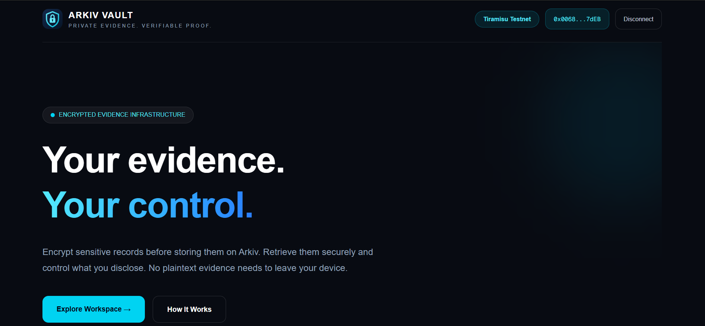
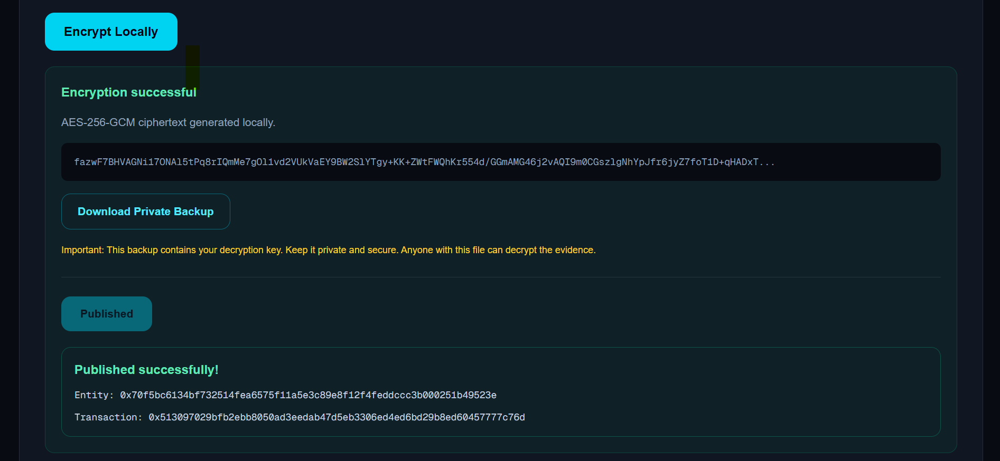
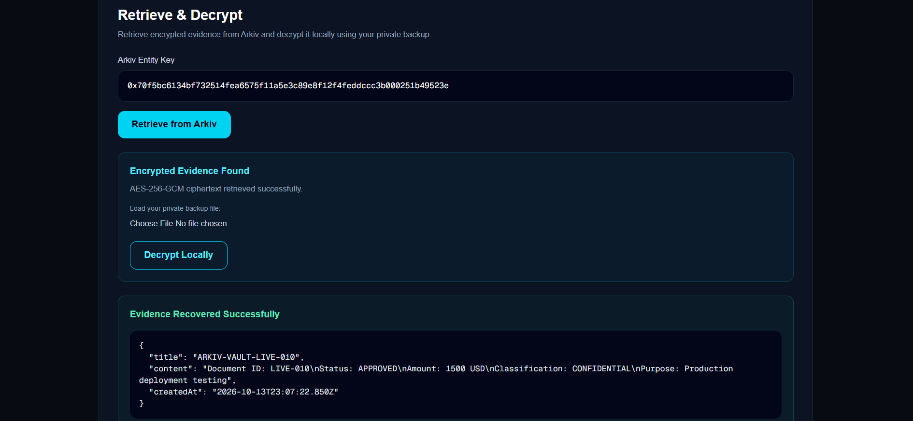
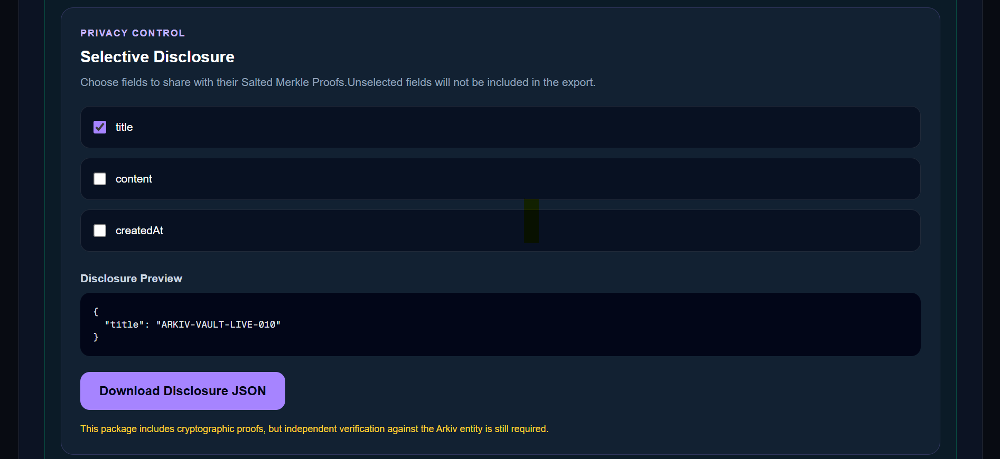
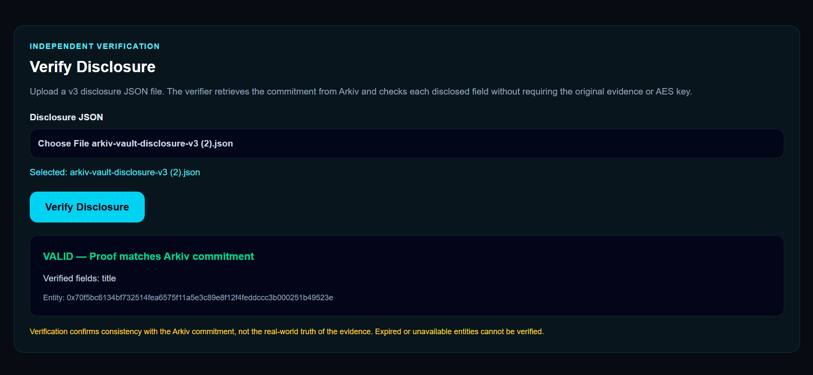
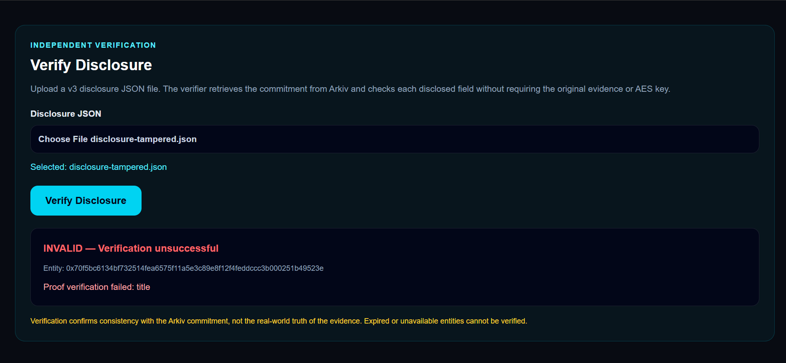

## Product Walkthrough

### 1. Arkiv Vault Dashboard



### 2. Publish Encrypted Evidence



### 3. Retrieve and Decrypt Evidence



### 4. Selective Disclosure



### 5. Verify Authentic Evidence



### 6. Detect Tampered Evidence



---

# Arkiv Vault

**Live Demo:** https://arkiv-vault.vercel.app/

**Network:** Arkiv Tiramisu Testnet (Chain ID: 7738577)

**Encrypted Evidence Storage with Verifiable Selective Disclosure**

Arkiv Vault is a privacy-focused application built on Arkiv Network. It allows users to encrypt evidence locally, publish encrypted records, recover them securely, and disclose selected fields with cryptographic proofs.

## Features

- **Client-side encryption:** AES-256-GCM encryption before publishing.
- **Arkiv storage:** Encrypted evidence is published to Arkiv Tiramisu.
- **Private recovery:** Evidence can be retrieved and decrypted using a private backup key.
- **Selective disclosure:** Share selected evidence fields without revealing the complete record.
- **Salted Merkle commitments:** Each field receives a random salt before commitment.
- **Independent verification:** Verify disclosed fields against a Merkle root retrieved from Arkiv.
- **Tamper detection:** Modified disclosed values fail cryptographic verification.

## How It Works

1. The user enters evidence in the browser.
2. Arkiv Vault encrypts the evidence using AES-256-GCM.
3. A salted Merkle commitment is generated for the evidence fields.
4. The encrypted payload and public commitment are published to Arkiv.
5. The user saves a private backup containing the decryption key.
6. Evidence can be retrieved from Arkiv and decrypted locally.
7. The user selects fields to disclose.
8. A disclosure package containing selected values, salts, and Merkle proofs is generated.
9. A verifier retrieves the commitment from Arkiv and checks the disclosed fields.

## Technology Stack

- Next.js 16
- React 19
- TypeScript
- Tailwind CSS
- Arkiv SDK
- Viem
- Wagmi
- Web Crypto API

## Run Locally

Requirements:

- Node.js
- npm
- A browser with a compatible EVM wallet for publishing

```bash
cd web
npm ci
npm run dev
```


Open http://localhost:3000 in your browser.

## Tests

Run from the web directory:

- npx tsc --noEmit
- npx tsx --test tests/*.test.ts
- npm run build

The automated suite contains 35 passing tests.

## Verified End-to-End Demo

The following workflow was manually tested on Arkiv Tiramisu:

1. Encrypt evidence locally.
2. Publish encrypted evidence to Arkiv.
3. Retrieve and decrypt evidence.
4. Generate a v3 selective disclosure package.
5. Verify an authentic disclosure against Arkiv.
6. Reject a disclosure with a tampered field value.

### Latest Published Demo Entity

The following encrypted evidence entity was published successfully on Arkiv Tiramisu on October 13, 2026.

**Entity key:**

`0xbf73b41c9289b8ba8193f63af54bb88ae9170e99d05645ba4447a2377dfb4bbb`

**Transaction hash:**

`0xba979d83fac3bb03ac78c594e6836f6aa856cf0ded1068550faad8cb7a59cef2`

The entity was confirmed through the Arkiv SDK with an encrypted payload, a v3 salted Merkle root, and a 30-day expiration configuration.

The full encryption, retrieval, selective disclosure, valid-proof verification, and tamper-rejection workflow was also tested end-to-end using an earlier evidence entity.

**Try the application:** https://arkiv-vault.vercel.app/

## Security and Limitations

- Encryption and decryption happen in the browser.
- Private backup files contain the decryption key and must remain confidential.
- Selective disclosure operates on top-level evidence fields.
- Verification proves consistency with a commitment, not real-world truth.
- Verification depends on the Arkiv RPC endpoint.
- This is not a zero-knowledge proof system.
- Newly published entities use a 30-day expiration setting. Actual availability depends on Arkiv network conditions and block progression.
- The prototype has not undergone an independent security audit.

## Network

Arkiv Tiramisu Testnet, Chain ID: 7738577.

## Project Status

Functional hackathon prototype with successful end-to-end testing.


## Arkiv Tiramisu On-Chain Evidence

Arkiv Vault publishes encrypted evidence and public Merkle
commitments to the Arkiv Tiramisu testnet.

| Item | Value |
| --- | --- |
| Network | Arkiv Tiramisu Testnet |
| Chain ID | `7738577` |
| Publisher wallet | `0x0068bEAe5c69f1eeca972C5b843C6131FFc17dEB` |
| Demo entity key | `0xbf73b41c9289b8ba8193f63af54bb88ae9170e99d05645ba4447a2377dfb4bbb` |
| Demo transaction hash | `0xba979d83fac3bb03ac78c594e6836f6aa856cf0ded1068550faad8cb7a59cef2` |

The publisher wallet is a dedicated testnet wallet used
for Arkiv Vault development.

The application uses Arkiv entities to store encrypted
payloads and public Merkle commitments. Decryption keys
remain outside Arkiv.
